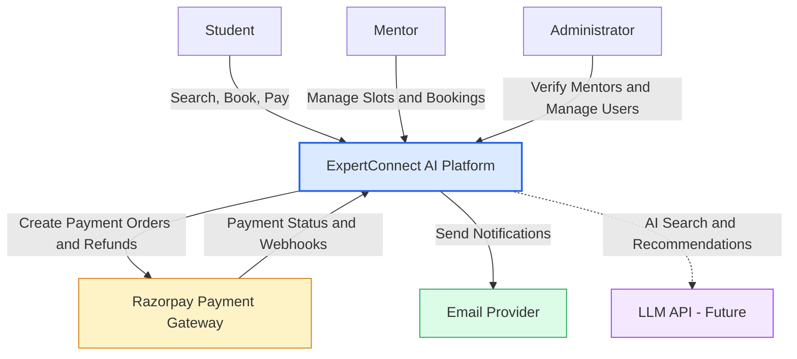
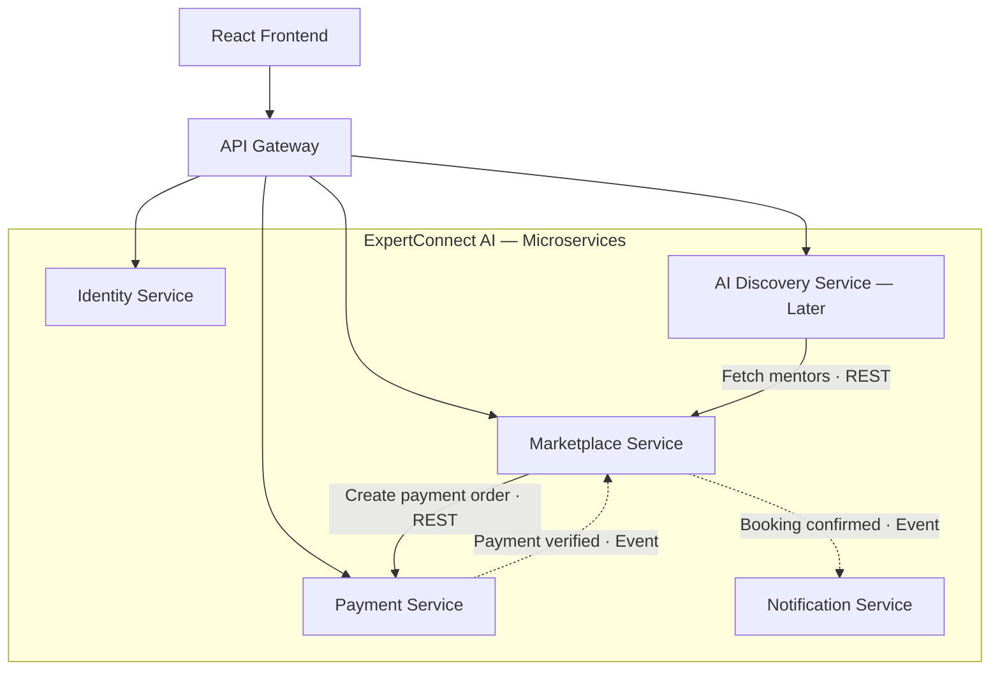
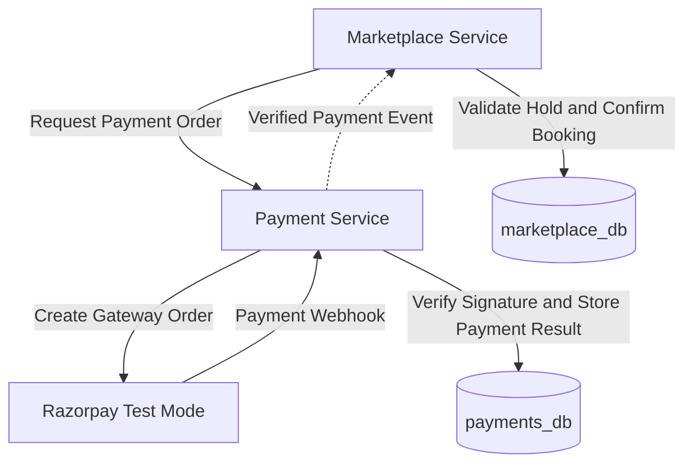
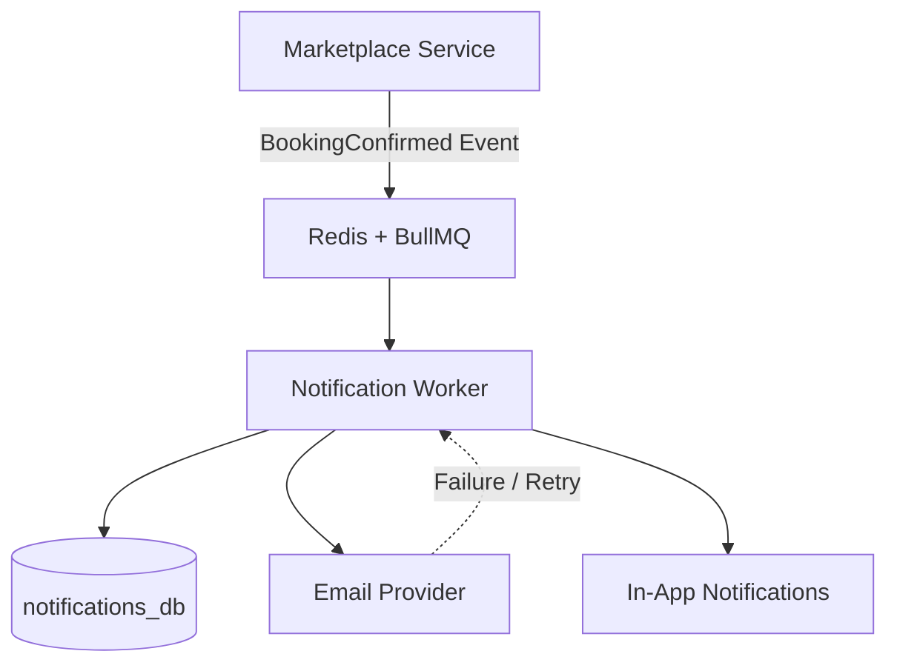
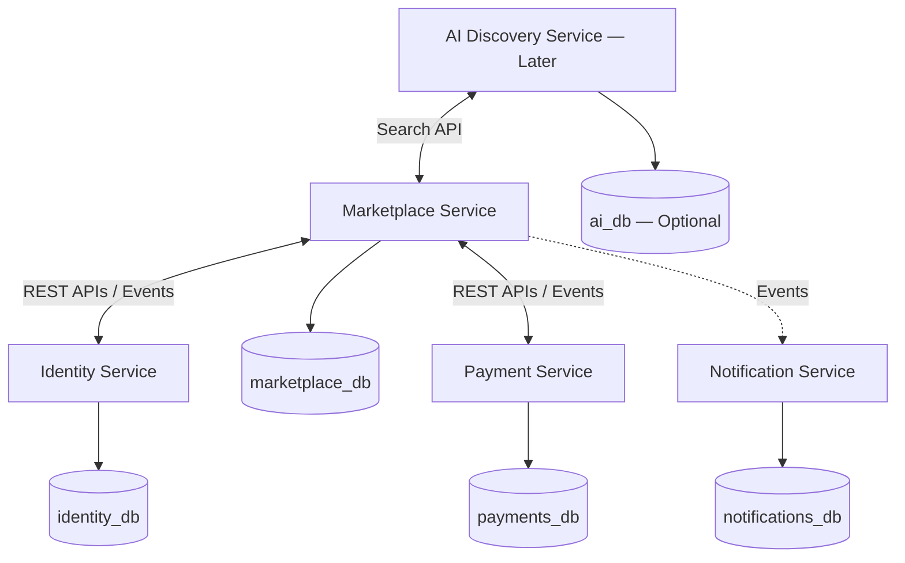
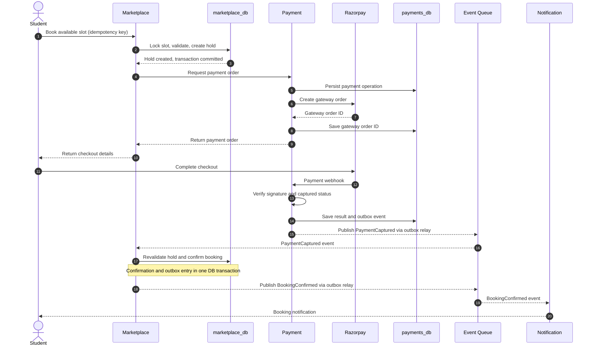
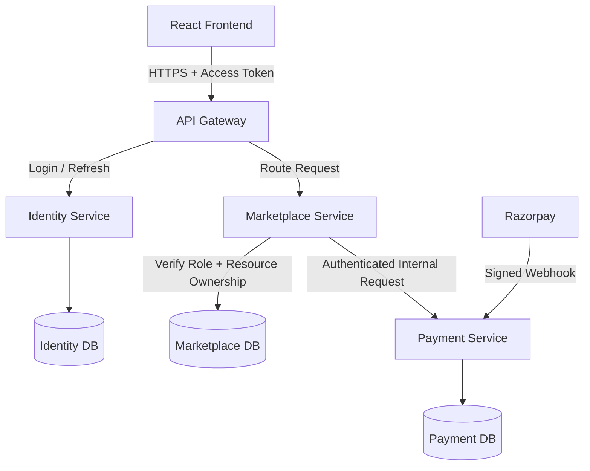

## 1. System Overview

### 1.1 System Purpose

ExpertConnect AI is a platform that connects students with experienced software engineering mentors.

- Students can search mentors based on skills, experience, budget, and availability.
- Students can reserve available sessions and complete payments.
- Mentors can manage their profiles, availability, and session prices.
- Administrators can review and approve mentor applications.
- The system sends booking confirmations, cancellation updates, and relevant notifications.

### 1.2 Architecture

ExpertConnect AI is designed around five main services:

1. **Identity Service:** Handles authentication, authorization, and user sessions.
2. **Marketplace Service:** Manages mentor profiles, availability, and bookings.
3. **Payment Service:** Handles payment orders, verification, and refunds.
4. **Notification Service:** Manages email and in-app notifications.
5. **AI Discovery Service:** Handles natural-language search and intelligent mentor recommendations.

Each service has a specific responsibility and communicates with other services through defined interfaces.

This separation helps maintain clear ownership, independent development, and fault isolation. However, microservices also introduce additional complexity, such as network failures and distributed data consistency.

We will implement the architecture incrementally rather than building all five services simultaneously.

### 1.3 External Dependencies

- **Payment Gateway (Razorpay Test Mode):** Processes simulated payments and refunds.
- **Email Provider:** Delivers booking confirmations and other email notifications.
- **LLM API (Future):** Supports natural-language understanding and mentor recommendations.

## 2. System Context Diagram

This diagram shows how external actors and third-party systems interact with ExpertConnect AI.

## 3. Microservices Architecture

### 3.1 Architecture Diagram

### 3.2 Architecture Explanation

ExpertConnect AI follows a microservices-based architecture in which each service has a specific business responsibility.

**API Gateway:**

The API Gateway acts as the common entry point for client requests. It routes requests to the appropriate services and supports authentication checks, rate limiting, and traffic management. Individual services remain responsible for enforcing authorization and business rules.

**Marketplace and Payment Communication:**

When a student requests a booking, the Marketplace Service checks availability and creates a temporary reservation. It then requests a payment order from the Payment Service.

The Payment Service communicates with the payment gateway and verifies payment results. Once payment is successfully verified, the Marketplace Service receives the payment outcome and determines whether the booking can be confirmed.

**Asynchronous Notifications:**

When a booking is confirmed, the system generates a notification event. The Notification Service processes this event asynchronously.

This ensures that a temporary notification failure does not affect an already confirmed booking. Failed notifications can be retried after recovery.

**Failure Handling:**

If a payment succeeds while Marketplace Service is unavailable, the verified payment outcome must be persisted and reliably delivered for later processing.

The system must reconcile payment and booking states without creating duplicate bookings or losing financial information.

Detailed communication patterns, retries, and failure recovery mechanisms will be covered in later sections.

## 4. Service Responsibilities

### 4.1 Marketplace Service

**Responsibilities:**
- Manage mentor profiles, technical skills, session prices, and availability.
- Retrieve relevant mentors based on student search filters.
- Manage booking holds, confirmed bookings, cancellations, and booking expiration.
- Prevent conflicting slot reservations using database transactions and pessimistic row-level locking.
- Coordinate with Payment Service to request payment orders and process verified payment outcomes.
- Publish booking confirmation and cancellation events for Notification Service.
- Maintain the booking status and agreed session price.

**Must Not:**
- Handle user passwords, authentication credentials, or token generation.
- Directly communicate with the payment gateway or independently mark payments as successful.
- Directly send emails or manage notification delivery.
- Access databases owned by other microservices.
- Allow an AI recommendation to bypass booking availability or authorization checks.

**Important Business Rules:**
- Only one active reservation or confirmed booking can exist for a slot.
- Repeated submissions of the same logical booking request must not create duplicate reservations.
- A confirmed booking must have trusted payment verification.
- The agreed booking price must remain unchanged.

### 4.2 Identity Service

**Responsibilities:**
- Handle user registration and login.
- Securely hash and verify passwords.
- Generate and validate access tokens and manage refresh-token sessions.
- Manage user roles (Student, Mentor, Administrator).
- Support logout, session revocation, and authentication-related security checks.

**Must Not:**
- Directly access Marketplace, Payment, or Notification databases.
- Create or modify bookings.
- Process payments or refunds.
- Decide whether a student can modify a particular booking; Marketplace must enforce resource-level authorization.

### 4.3 Payment Service

**Responsibilities:**
- Create payment orders for valid booking requests received from Marketplace Service.
- Integrate with Razorpay Test Mode to process payments.
- Verify payment signatures and webhook authenticity.
- Track payment states, including pending, captured, and failed.
- Handle duplicate payment requests and webhook events using idempotency.
- Initiate and track refunds for eligible cancelled bookings.
- Publish verified payment events for Marketplace Service.
- Store payment transactions and refund records in its own database.

**Must Not:**
- Directly modify booking status or mentor availability.
- Access Marketplace or Identity Service databases.
- Confirm a booking solely based on frontend payment responses.
- Process the same payment event multiple times as separate financial operations.
- Store sensitive card information such as CVV or full card numbers.

**Important Business Rules:**
- A payment must be verified before the Marketplace Service can confirm its associated booking.
- Duplicate webhooks must not cause duplicate logical payment processing.
- Refund requests must be tracked until their final status is known.
- Payment events must be retained reliably when Marketplace Service is temporarily unavailable.

### 4.4 Notification Service

**Responsibilities:**
- Process booking confirmation, cancellation, and refund-related notification events.
- Send email and in-app notifications to students and mentors.
- Process notification jobs asynchronously using Redis and BullMQ.
- Track notification delivery status and failed delivery attempts.
- Retry failed notifications without affecting confirmed bookings.
- Handle duplicate events idempotently to avoid duplicate logical notifications.
- Preserve the original booking confirmation timestamp in delayed notifications.

**Must Not:**
- Directly modify booking or payment records.
- Access databases owned by other microservices.
- Decide whether a booking or payment is successful.
- Block booking confirmation while waiting for email delivery.

**Important Business Rules:**
- Notification failures must not cancel confirmed bookings.
- Failed notifications should be retried according to a defined retry policy.
- Notifications that repeatedly fail must be recorded for investigation.
- Repeated processing of the same event must not create duplicate logical notification records.

### 4.5 AI Discovery Service

**Responsibilities:**
- Understand students' natural-language search requests.
- Extract structured filters such as skills, experience level, budget, and availability.
- Communicate with Marketplace Service to retrieve relevant mentors.
- Rank and recommend mentors based on students' preferences.
- Support semantic search using embeddings in future versions.
- Validate AI-generated structured outputs before using them.

**Must Not:**
- Directly create, modify, or cancel bookings.
- Access Marketplace Service's database directly.
- Modify mentor prices or availability.
- Process payments or refunds.
- Treat AI-generated results as authoritative without verification.

**Important Business Rules:**
- Marketplace Service remains the source of truth for mentor availability, prices, and eligibility.
- AI-generated recommendations must respect the student's validated constraints.
- Invalid AI responses must be rejected or handled safely.

**MVP Status:** Advanced feature, implemented after the core booking and payment workflow.

## 5. Database Ownership

### 5.1 Database Ownership Principle

Each data-owning microservice maintains its own database and controls access to its data.

Services must communicate using defined REST APIs or asynchronous events rather than directly accessing another service's database.

This separation reduces coupling and allows services to manage their own schemas and migrations independently.

### 5.2 Database Ownership Overview

| Service | Database | Main Entities |
|---|---|---|
| Identity Service | identity_db | User, Credential, Session, Role |
| Marketplace Service | marketplace_db | MentorProfile, AvailabilitySlot, Booking |
| Payment Service | payments_db | PaymentOrder, PaymentTransaction, Refund, WebhookEvent |
| Notification Service | notifications_db | Notification, DeliveryAttempt, ProcessedEvent |
| AI Discovery Service | ai_db (optional, future) | EmbeddingRecord, SearchEvaluation |

### 5.3 Marketplace Database

The Marketplace Service owns the data required for mentor discovery, scheduling, and booking.

**Core Entities:**

- **MentorProfile:** Stores mentor details, skills, experience, and approval status.
- **AvailabilitySlot:** Stores available session times, prices, and reservation-related state.
- **Booking:** Stores student and mentor references, reserved slot, agreed price, booking status, and hold expiration time.

A booking hold can initially be represented by a Booking record with a pending-payment status and expiration timestamp.

**Important Rules:**
- Only Marketplace Service can modify booking records.
- Booking creation and slot reservation must occur in the same database transaction.
- Pessimistic row-level locking will initially coordinate concurrent reservation requests.
- Each slot must have at most one active reservation or confirmed booking.
- References to users and payment orders are stored as identifiers without cross-service database foreign keys.

### 5.4 Other Service Databases

**Identity Database:** Owns account credentials, roles, and sessions.

**Payment Database:** Owns payment orders, gateway transaction records, webhook processing records, and refunds.

**Notification Database:** Owns notifications, delivery attempts, and processed-event records.

**AI Database (Future):** May store embeddings and search evaluations when independent AI persistence becomes necessary.

### 5.5 Cross-Service Data References

Services store references to external entities using identifiers.

For example, Marketplace stores the student's user ID but does not store the student's password or login credentials.

When additional information is required, services use authorized API requests or trusted events rather than cross-service database queries.

## 6. Service Communication

### 6.1 Synchronous Communication (REST APIs)

Synchronous communication is used when one service needs an immediate response from another service.

**Examples:**

- API Gateway communicates with Identity Service for registration and login.
- API Gateway communicates with Marketplace Service for mentor searches and booking requests.
- Marketplace Service requests payment order creation from Payment Service.
- AI Discovery Service requests mentor information from Marketplace Service.
- Notification Service requests authorized user contact information from Identity Service.

**Important Rules:**
- All service-to-service requests must use authenticated communication.
- Requests must have appropriate timeouts.
- A failed request must return a meaningful error or trigger a safe recovery mechanism.
- Services must not directly access databases owned by other services.

### 6.2 Asynchronous Communication (Events and Queues)

Asynchronous communication is used when work can be processed independently without requiring the original request to remain open.

**Examples:**

- Payment Service publishes a verified payment event for Marketplace Service.
- Marketplace Service publishes a booking confirmation event.
- Notification Service processes booking notification jobs.
- Payment and Marketplace Services coordinate refund-related events.

**Technology:** Redis and BullMQ will initially support background jobs and asynchronous workflows.

**Important Rules:**
- Failed jobs must support retries.
- Consumers must handle repeated event delivery safely.
- Important events must be persisted reliably before publication.
- Different consumer workflows should use appropriately designed queues.
- Temporary service failures must not cause confirmed bookings or verified payments to be lost.

### 6.3 Communication Failure Handling

**Scenario 1 — Payment Service unavailable**

If Payment Service is unavailable during payment order creation:

- Marketplace must not wait indefinitely.
- The request should time out within a configured limit.
- The existing booking hold may remain valid until its expiration.
- The student may safely retry payment initiation using idempotency.
- If payment cannot be initiated, the hold eventually expires.

**Scenario 2 — Notification Service unavailable**

- Already confirmed bookings remain valid.
- Notification work is retained for later processing.
- Workers retry delivery after recovery.
- Repeated failures are recorded for investigation.

**Scenario 3 — Marketplace Service unavailable after successful payment**

- Payment Service preserves the verified payment result.
- The payment outcome is delivered or reconciled when Marketplace recovers.
- Marketplace checks the booking state before confirmation.
- Invalid or expired reservations must be reconciled without creating double bookings.

### 6.4 Communication Design Decisions

- Use REST APIs when an immediate response is necessary.
- Use asynchronous processing for notifications and payment outcome events.
- Use timeouts to prevent indefinite waiting.
- Use idempotency for safely repeated operations.
- Use retries, reconciliation, and eventually a transactional outbox for reliable distributed workflows.

## 7. Main Data Flows

### 7.1 Booking and Payment Confirmation Flow

**Purpose:** Allow a student to reserve an available mentor slot, complete payment, and receive booking confirmation.

**Step 1 — Booking Request**

The student selects an available mentoring slot and sends a booking request containing an idempotency key.

**Step 2 — Temporary Reservation**

Marketplace Service starts a database transaction, acquires a pessimistic row-level lock on the selected slot, and checks its availability.

If available, it creates a temporary booking hold with an expiration time. The transaction commits and releases the database lock.

**Step 3 — Payment Order Creation**

Marketplace Service requests a payment order from Payment Service.

Payment Service records the payment operation, communicates with Razorpay Test Mode, and returns the gateway order details.

**Step 4 — Payment Processing**

The student completes checkout using Razorpay.

Payment Service independently verifies the payment outcome through trusted gateway evidence, including authenticated webhook events.

**Step 5 — Booking Confirmation**

Payment Service persists the verified captured payment and reliably publishes a `PaymentCaptured` event.

Marketplace Service consumes this event, revalidates the booking hold, and confirms the booking if all conditions are satisfied.

**Step 6 — Notification**

Marketplace Service reliably publishes a `BookingConfirmed` event.

Notification Service consumes the event and processes email and in-app notifications asynchronously.

### 7.2 Important Design Guarantees

- The database lock is released before the student begins payment.
- Only one active reservation can exist for a slot.
- Repeated booking requests must be idempotent.
- Payment Service owns payment status; Marketplace owns booking status.
- Payment success alone does not guarantee booking confirmation.
- Critical events must survive temporary service failures.
- Notification failures must not invalidate confirmed bookings.

### 7.3 Alternative Flows

The following scenarios will be detailed in Section 8 — Reliability and Failure Handling:

- Slot already reserved by another student.
- Temporary hold expires without payment.
- Payment fails or remains pending.
- Payment succeeds after reservation expiration.
- Duplicate or delayed payment webhook.
- Marketplace unavailable after successful payment.
- Notification Service unavailable after booking confirmation.

## 8. Reliability and Failure Handling

### 8.1 Reliability Strategy

ExpertConnect AI must handle temporary failures without losing confirmed bookings, verified payments, or important business events.

The system uses database transactions, idempotency, asynchronous processing, retries, and reconciliation to maintain consistency across microservices.

### 8.2 Transactional Outbox Pattern

The Transactional Outbox Pattern ensures that important business events are persisted together with their corresponding database changes.

**Booking Confirmation Example:**

1. Marketplace Service begins a database transaction.
2. Updates the booking status to `CONFIRMED`.
3. Inserts a `BookingConfirmed` event into the `OutboxEvent` table.
4. Commits both changes atomically.
5. An Outbox Worker reads unpublished events.
6. The worker publishes them to the appropriate Redis/BullMQ queue.
7. After successful publication acknowledgement, the worker records the publication status.

If event insertion fails, the entire transaction rolls back.

If the worker crashes after publishing but before recording success, the event may be published again. Consumers must therefore handle duplicate events safely.

**Important:** The outbox ensures that events can be recovered; it does not guarantee exactly-once delivery.

### 8.3 Idempotency and Duplicate Events

The system must safely handle repeated API requests, payment webhooks, and asynchronous events.

**Expected Behavior:**
- Repeated booking requests with the same idempotency key must not create duplicate reservations.
- Duplicate payment webhooks must not create duplicate financial operations.
- Consumers must identify already-processed events using a unique event ID.
- Processing the same `BookingConfirmed` event repeatedly must not create multiple logical notifications.
- Event-processing records and corresponding local business changes should be committed atomically where applicable.

### 8.4 Failure Scenarios and Recovery

**Scenario A — Marketplace unavailable after successful payment**

- Payment Service persists the verified payment result.
- The payment outcome remains available for reliable delivery or reconciliation.
- Marketplace processes the result after recovery.
- Marketplace validates the reservation before confirming the booking.
- If confirmation is impossible, the system initiates an appropriate refund or exception-handling workflow.

**Scenario B — Outbox Worker crashes**

- Unpublished events remain stored in the service database.
- After recovery, the worker retries pending publications.
- Duplicate publication is possible and must be handled by consumers.

**Scenario C — Notification Service unavailable**

- Confirmed bookings remain unchanged.
- Pending notification work is retained.
- Failed jobs are retried after recovery.
- Repeated failures are recorded for investigation.

**Scenario D — Booking hold expires during payment**

- Marketplace checks whether payment is pending, completed, or requires reconciliation.
- The system must not confirm two bookings for the same slot.
- A captured payment that cannot result in a valid booking must enter a refund or exception-resolution workflow.

**Scenario E — Payment Service unavailable during order creation**

- Marketplace applies a request timeout.
- The student receives an appropriate pending or failure response.
- Retries use the original idempotency key.
- Duplicate payment operations must be avoided.

### 8.5 Retry and Recovery Policies

- Retry only operations that can safely be repeated.
- Use bounded retry attempts with exponential backoff.
- Preserve failed operations for investigation or later reconciliation.
- Do not retry unavailable booking slots indefinitely.
- Use timeouts for synchronous inter-service requests.
- Record failures using structured application logs.

### 8.6 Reliability Guarantees

- A slot must never have two active confirmed bookings.
- Verified captured payments must not be silently lost.
- Confirmed bookings must remain valid during notification outages.
- Important business events must survive application crashes.
- Duplicate events must not create duplicate logical business operations.
- Cross-service inconsistencies must be detected and reconciled.

## 9. Security Architecture

### 9.1 Authentication

Identity Service is responsible for authenticating users and managing sessions.

**Design Decisions:**
- Passwords are stored using a secure password-hashing algorithm such as Argon2id.
- Short-lived JWT access tokens are used to authenticate requests.
- Refresh tokens support session renewal and must be stored securely.
- Refresh-token rotation and session revocation are supported.
- Invalid or expired tokens are rejected.
- Authentication endpoints are protected using rate limiting.

### 9.2 Authorization and Access Control

ExpertConnect AI uses Role-Based Access Control (RBAC).

**Roles:**
- **Student:** Search mentors, create bookings, and view or cancel eligible personal bookings.
- **Mentor:** Manage personal mentor profiles, prices, availability, and eligible session cancellations.
- **Administrator:** Review mentor applications, approve or reject mentors, and perform authorized administrative actions.

**Important Rules:**
- Students cannot modify another student's bookings.
- Mentors cannot modify other mentors' availability.
- Only approved mentors can publish bookable slots.
- Users cannot assign themselves privileged roles.
- Services must verify both user permissions and resource ownership.

### 9.3 API Gateway Security

The API Gateway acts as the public entry point.

**Responsibilities:**
- Route requests to the appropriate microservice.
- Perform initial authentication checks where applicable.
- Apply request limits and appropriate security controls.
- Enforce HTTPS for external communication.

Individual services remain responsible for enforcing their own authorization and business rules.

### 9.4 Inter-Service Security

Internal microservices must authenticate requests from other services.

**Design Decisions:**
- Service-to-service requests use authenticated communication.
- Internal endpoints are not exposed directly to the public internet.
- Short-lived service credentials or mutually authenticated TLS can be used according to the deployment environment.
- Services receive only the permissions necessary for their responsibilities.
- Services cannot directly access databases owned by other services.
- Asynchronous event producers and consumers must use authenticated queue access.

### 9.5 Payment Security

Payment Service is responsible for trusted payment verification.

**Security Rules:**
- Verify Razorpay webhook authenticity before processing financial events.
- Verify payment amounts, currency, and booking references against server-side records.
- Never trust frontend payment success messages as final confirmation.
- Prevent duplicate payment processing using idempotency.
- Store payment gateway secrets securely.
- Never store CVV or complete payment-card details.

### 9.6 Data Protection

- Sensitive configuration values and secrets must not be committed to Git.
- Database credentials must be restricted to the owning service.
- Passwords, access tokens, and payment secrets must not be written to application logs.
- APIs should expose only the information required by the requesting user or service.
- Validate incoming API requests before processing them.
- Restrict cross-origin requests and protect cookie-based authenticated operations against CSRF.

### 9.7 Audit Logging and Monitoring

Security-sensitive operations must be traceable.

**Important Events:**
- Login failures and suspicious authentication attempts.
- Mentor approval or rejection.
- Administrative changes.
- Booking cancellations.
- Refund requests and payment webhook failures.
- Repeated unauthorized access attempts.

Audit logs must not expose sensitive credentials or confidential payment information.

## 10. Architectural Decisions and Trade-offs

### 10.1 Microservices Architecture

**Decision:** Use a microservices-based architecture with separate business responsibilities.

**Why:**
- Establish clear ownership of authentication, marketplace, payments, and notifications.
- Allow services to evolve independently.
- Isolate certain failures between business components.
- Provide practical experience with distributed systems.

**Trade-offs:**
- More complex development, testing, and deployment.
- Network communication introduces latency and possible failures.
- Maintaining consistency across services requires additional mechanisms.

**Approach:** Build services incrementally rather than implementing all services simultaneously.

### 10.2 PostgreSQL and Database per Service

**Decision:** Use PostgreSQL with logically separate databases for data-owning services.

**Why:**
- Provides ACID transactions and strong relational integrity.
- Supports row-level locking for booking concurrency.
- Allows independent data ownership and schema migrations.

**Trade-offs:**
- Cross-service joins are not directly available.
- Changes spanning services require APIs, events, or reconciliation.
- Multiple databases increase operational complexity.

**Approach:** Initially use a shared PostgreSQL server with separate databases and credentials for each service.

### 10.3 Pessimistic Locking for Booking Concurrency

**Decision:** Initially use PostgreSQL row-level locking for slot reservations.

**Why:**
- Prevent competing requests from simultaneously reserving the same slot.
- Makes slot availability checks and reservation updates atomic.
- Provides a straightforward concurrency model for the initial implementation.

**Trade-offs:**
- Contending requests may wait for database locks.
- Long transactions can reduce throughput and increase deadlock risk.
- High contention requires careful monitoring and optimization.

**Approach:** Keep transactions short, release database locks before payment processing, and enforce uniqueness through database constraints.

The persisted booking hold remains active independently of the database lock.

### 10.4 REST APIs and Asynchronous Communication

**Decision:** Use synchronous REST APIs for immediate requests and asynchronous events for background workflows.

**Why:**
- REST provides a simple request-response model for authentication, searches, and payment-order creation.
- Asynchronous processing decouples payment outcomes and notifications from long-running client requests.

**Trade-offs:**
- REST introduces runtime dependencies between services.
- Asynchronous systems introduce eventual consistency, retries, and duplicate event delivery.

**Approach:** Use REST with timeouts and authenticated requests. Use Redis and BullMQ for asynchronous jobs, with idempotent processing and durable event publication.

### 10.5 Transactional Outbox Pattern

**Decision:** Use a transactional outbox for critical business events.

**Why:**
- Ensures that important events are recorded in the same transaction as the corresponding database changes.
- Allows event publication to resume after application crashes.

**Trade-offs:**
- Requires an additional OutboxEvent table and worker.
- Events may be published more than once.
- Consumers must handle duplicate messages safely.

**Approach:** Use at-least-once delivery with idempotent consumers rather than relying on exactly-once message delivery.

### 10.6 Payment and Booking Consistency

**Decision:** Keep payment and booking states separately owned, with event-driven coordination and reconciliation.

**Why:**
- Payment Service remains responsible for verified financial outcomes.
- Marketplace Service remains responsible for booking validity and confirmation.
- Services can recover from temporary failures independently.

**Trade-offs:**
- Payment capture and booking confirmation are not one atomic database transaction.
- Temporary inconsistencies are possible.
- Failed booking confirmation after successful payment may require compensation through refunds.

**Approach:** Persist financial outcomes, process payment events idempotently, reconcile inconsistent records, and initiate refunds where necessary.

### 10.7 AI Discovery as a Later Phase

**Decision:** Implement AI-powered mentor discovery after the core booking system is functional.

**Why:**
- Ensures the core business workflow works without AI.
- Prevents AI-generated results from becoming authoritative booking decisions.
- Allows future experimentation with natural-language search, embeddings, and ranking.

**Trade-offs:**
- Initial mentor discovery will use traditional search and filters.
- AI features will require additional integration, evaluation, and operational costs.

**Approach:** Introduce AI Discovery independently without allowing it to modify bookings, prices, or payment states.

### 10.8 Incremental Implementation Strategy

ExpertConnect AI will be implemented in stages:

1. Identity Service and authentication.
2. Marketplace Service with mentor profiles and availability.
3. Booking holds and concurrency control.
4. Payment Service with Razorpay Test Mode.
5. Notification Service with Redis and BullMQ.
6. Transactional outbox, reconciliation, and advanced reliability testing.
7. AI Discovery Service and intelligent mentor recommendations.

Each stage should be implemented, tested, and reviewed before adding further complexity.

### 10.9 Future Architectural Improvements

The following decisions may be revisited based on measured system requirements:

- Compare pessimistic and optimistic locking under realistic concurrent workloads.
- Add distributed tracing and centralized monitoring.
- Introduce more advanced event infrastructure if queue requirements grow.
- Improve scalability through caching and database indexing.
- Evaluate dedicated infrastructure and independent deployments when justified.

The architecture should evolve based on verified requirements and performance measurements rather than unnecessary complexity.